# VietGraph — Vietnamese PDF to Knowledge Graph

> Turn unstructured Vietnamese PDF documents into traceable knowledge graphs with Gemini extraction, hybrid entity matching, human review, and Neo4j.

VietGraph is a full-stack application for extracting entities and relationships from Vietnamese PDF documents, resolving duplicate entity mentions, and publishing a canonical graph to Neo4j. It combines an LLM-based extraction pipeline with deterministic matching, embedding-based candidate retrieval, and a Human-in-the-Loop (HITL) review workflow.

**Project focus:** Python backend engineering, data modeling, API design, entity-resolution workflows, persistence, and graph database integration.

[Repository](https://github.com/pmhieu2193/text_to_graph) · [API documentation](http://localhost:8000/docs) · [Neo4j Browser](http://localhost:7474)

---

## 1. Project at a glance

| Item | Description |
|---|---|
| Project | VietGraph — Vietnamese PDF to Knowledge Graph |
| Problem | PDF extraction often produces duplicate, inconsistent entity names and noisy relationships |
| Solution | Extract raw entities/relations, generate duplicate candidates, review/merge them, and sync canonical data to Neo4j |
| Primary backend | Python, FastAPI, SQLAlchemy, Alembic |
| LLM | Google Gemini (currently the supported provider) |
| Entity matching | RapidFuzz + BGE-M3 embeddings + FAISS |
| Databases | SQLite for application/workflow data; Neo4j for graph storage |
| Frontend | React, TypeScript, Vite |
| Deployment | Docker Compose |

### Why this project?

A knowledge graph built directly from LLM output can contain duplicate nodes, inconsistent labels, and redundant edges. VietGraph separates **raw extraction** from **entity resolution** so that the original evidence remains available while canonical entities are reviewed and synchronized to a graph database.

## 2. Demo & User Guide

This section provides an overview of the application's main features and
guides users through the document-to-knowledge-graph workflow.

### 2.1. Dashboard

The dashboard provides an overview of the application and its
document-processing activities.

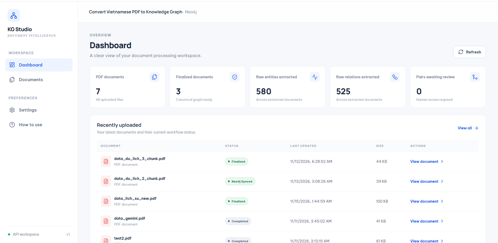

### 2.2. Document Management

The Documents page displays uploaded documents and their current
processing statuses. Users can:

-   Upload new PDF documents.
-   Delete documents that are no longer needed, along with their
    associated data.
-   Search and filter the document list.
-   Check the processing progress of each document.
-   Resume processing for documents that have not completed the
    workflow.
-   Restart the workflow from the Entity Resolution stage when a new
    extraction run is unnecessary, helping avoid additional LLM API
    usage.

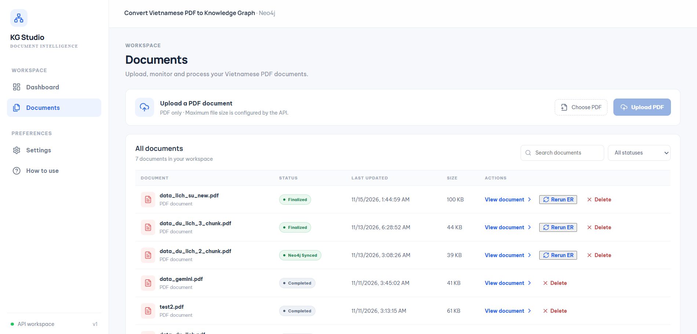

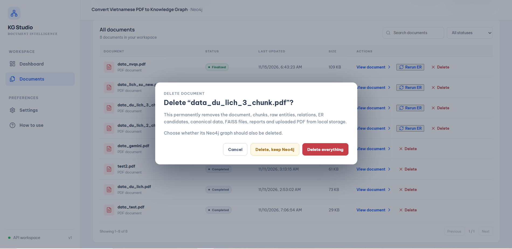

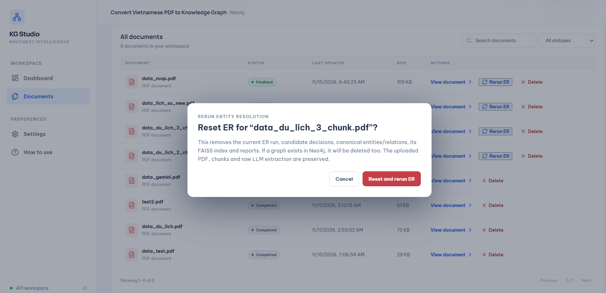

### 2.3. Document Processing

The processing workflow is divided into separate stages so users can
track the current status of a document and inspect data produced by
previous stages.

This part of the workflow focuses on preparing the document for
extraction, including document cleaning and splitting the content into
smaller chunks.

Users can navigate between completed stages to review previously
processed data. If an error occurs, the document remains at its latest
successfully completed state, allowing the workflow to be resumed rather
than restarted from the beginning.

For users who are already familiar with the workflow and want a quicker
experience, **Quick Process** provides a shortcut to the Human Review
stage. Data from previous processing stages remains available for
inspection.

#### 2.3.1. Document Chunking

The application displays the generated chunks and their content. Users
can inspect the chunk list and open individual chunks to review their
contents. Select **Next** to continue to the next stage.

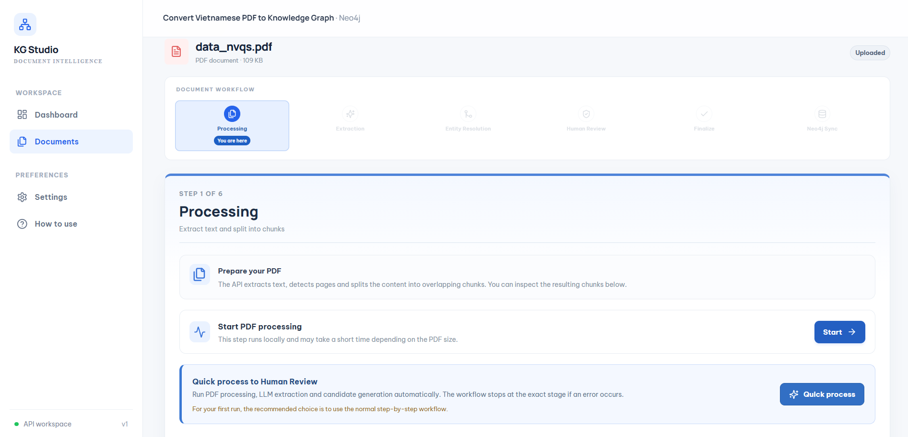

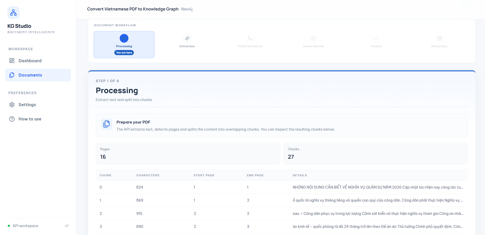

### 2.4. Entity and Relationship Extraction

At this stage, the application uses an LLM API to extract entities and
relationships from the document chunks. Users need to configure an API
key before starting the extraction process.

Processing time depends on the internet connection, API provider, and
selected model. Extraction is performed chunk by chunk, and users can
monitor its progress. If an error interrupts the process, the extraction
can be resumed.

The extraction results include:

-   Statistics about the extracted data.
-   The list of extracted entities.
-   Entity aliases identified in each chunk.
-   Source information for the extracted data.
-   The LLM's self-evaluation score for an extraction result.
-   Search functionality for entities and relationships.

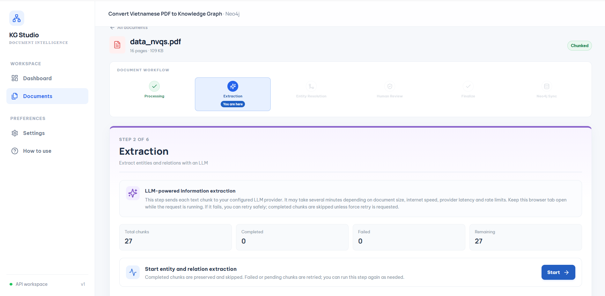

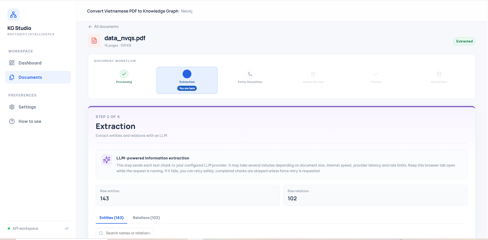


### 2.5. Entity Resolution

The Entity Resolution stage calculates and displays candidate entity
pairs that may refer to the same real-world entity. The application
classifies these candidate pairs to support the subsequent review
process.

Users can:

-   View the candidate pairs and their classification results.
-   Export an Excel report containing the candidate-pair results.
-   Open a candidate pair to inspect its details.

At this stage, users can inspect the candidate pairs, but cannot make
merge or separation decisions yet. Those decisions are made in the Human
Review stage.

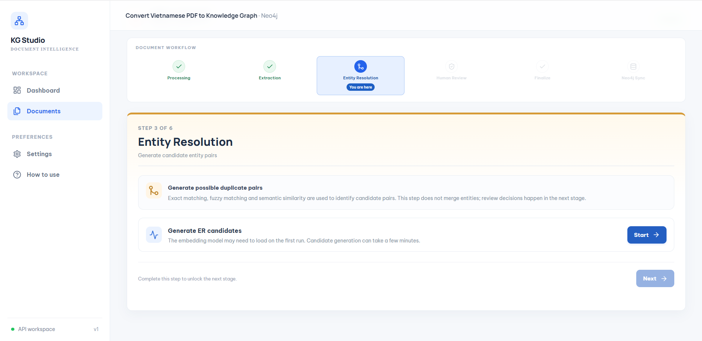

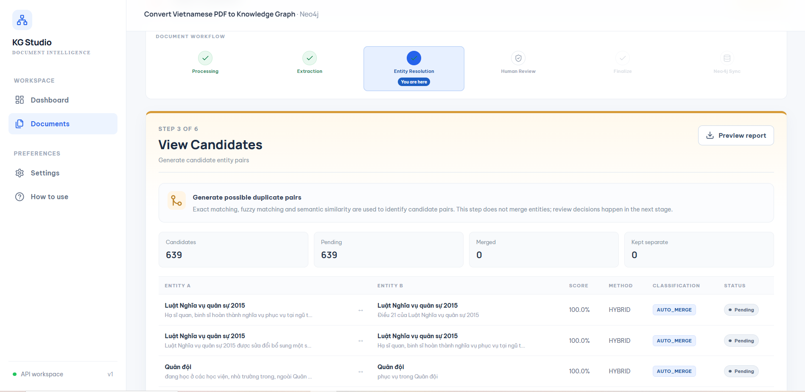

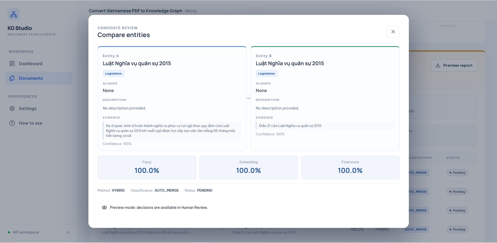

### 2.6. Human Review

The Human Review stage displays statistics and candidate pairs
classified into three categories:

-   **Auto Merge:** Candidate pairs with very high final scores from
    fuzzy matching and embedding similarity. These pairs are considered
    highly confident matches based on textual similarity---including
    entity aliases---and semantic similarity.
-   **Review:** Candidate pairs with sufficiently high scores but
    without enough confidence for automatic merging. Users should
    inspect these pairs and make the final decision.
-   **Reject:** Candidate pairs classified as unsuitable for merging.

Users can process the Auto Merge group and review uncertain pairs
manually. For each pair in the Review group, the available decisions
are:

-   **Merge:** Treat the two candidate entities as the same entity.
-   **Keep Separate:** Keep the entities as separate entities.
-   **Skip:** Skip the current pair without making a merge decision.

Select a candidate pair to open its review panel and choose an action.

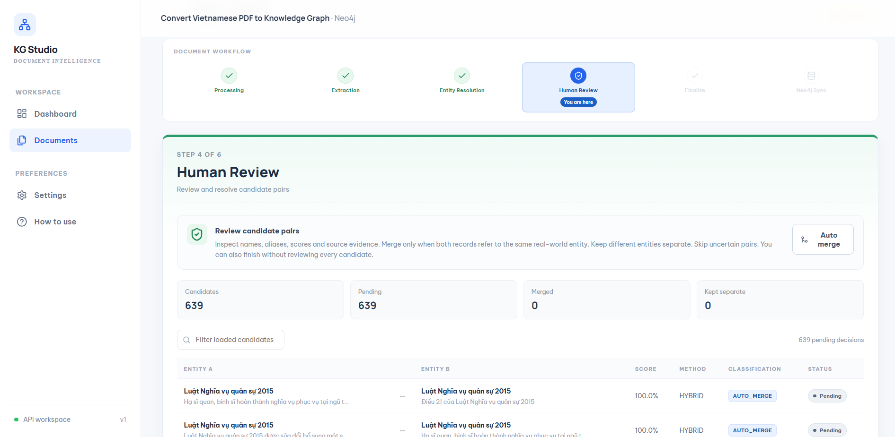

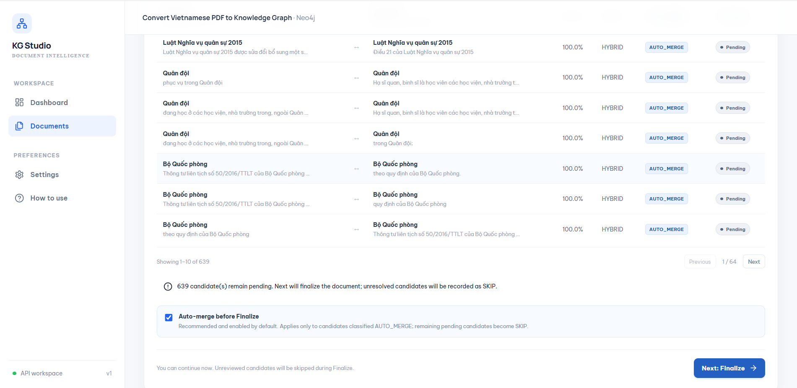

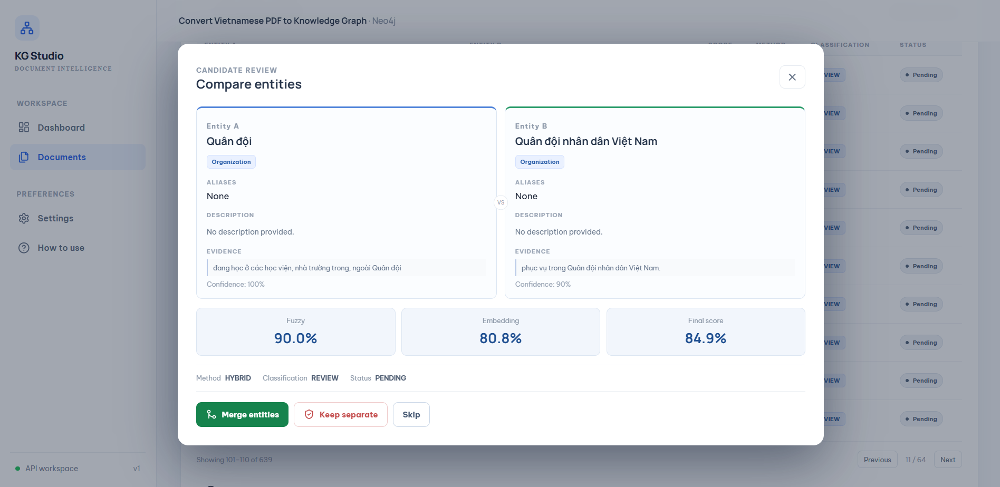

### 2.7. Finalization

After the merge decisions have been completed, proceed to the Finalize
stage. The application consolidates the entities and transfers their
relationships to the resulting canonical entities.

The page provides statistics about the graph data after extraction and
entity consolidation. Users can:

-   Review the resulting entities.
-   Inspect the relationships associated with the canonical entities.
-   Download a report of the finalized data.


### 2.8. Neo4j Synchronization

The Neo4j Sync stage allows users to connect to a Neo4j database and
generate the knowledge graph from the finalized data.

Users can also export the corresponding Cypher queries instead of
synchronizing directly with Neo4j.


### 2.9. Settings

The Settings page allows users to configure:

-   A primary LLM API key.
-   An optional backup API key.
-   The Neo4j database connection details.

The application currently supports Gemini models. Support for additional
LLM providers may be added in future updates.
⋮⋮⋮⋮

## 3. Key Features

### 3.1. Document Ingestion and Extraction

-   Upload and validate PDF documents.
-   Extract document text and split it into overlapping chunks.
-   Store document metadata, chunk content, and raw extraction records
    in the application database.
-   Use Gemini to extract structured entities, aliases, and
    relationships from Vietnamese text.
-   Preserve supporting evidence and source references to help trace
    extracted information back to the original document.

### 3.2. Hybrid Entity Resolution

-   Generate candidate entity pairs using exact matching and fuzzy
    string matching with RapidFuzz.
-   Generate semantic candidates using BGE-M3 embeddings and FAISS
    nearest-neighbor search.
-   Combine available matching scores to classify candidate pairs into
    **Auto Merge**, **Review**, and **Reject** groups.
-   Scope entity resolution to individual documents; separate documents
    maintain independent canonical entities.
-   Preserve the original entity and relationship extraction records
    rather than destructively modifying the raw extraction data.

### 3.3. Human-in-the-Loop Review

-   Review candidate entity pairs alongside their supporting evidence.
-   Support three review decisions: `MERGE`, `KEEP_SEPARATE`, and
    `SKIP`.
-   Apply automatic merging to candidate pairs classified as eligible
    for Auto Merge.
-   Handle transitive merge cases, such as A--B and B--C, based on
    current canonical-cluster membership.
-   Prevent merges that would violate an existing `KEEP_SEPARATE`
    decision.

### 3.4. Canonical Graph and Neo4j

-   Build canonical entities and maintain mappings from raw entity
    records to their canonical clusters.
-   Aggregate entity names and aliases within canonical entities.
-   Project raw relationships onto the corresponding canonical entity
    endpoints.
-   Deduplicate equivalent relationships and exclude self-loops
    introduced by entity merging from the graph view.
-   Generate a final XLSX report and a Cypher artifact for graph
    synchronization.
-   Synchronize a document's graph without replacing graph data
    belonging to other documents.

### 3.5. Workflow and Operations

-   Provide document-scoped API endpoints with pagination and filtering.
-   Support runtime configuration for LLM and Neo4j connections, while
    masking secrets in API responses.
-   Manage database schema changes with Alembic migrations.
-   Allow Entity Resolution to be reset and rerun while preserving the
    original extraction data.
-   Use Docker Compose to run the frontend, backend, and Neo4j with
    persistent storag

## 4. Tech stack

| Layer | Technologies |
|---|---|
| Backend/API | Python 3.11, FastAPI, Pydantic, Uvicorn |
| ORM and migrations | SQLAlchemy 2.x, Alembic |
| PDF processing | PyMuPDF |
| LLM extraction | Google Gemini via Google Gen AI SDK |
| String matching | RapidFuzz |
| Embeddings | BAAI BGE-M3, Sentence Transformers / FlagEmbedding |
| Vector retrieval | FAISS |
| Relational/workflow storage | SQLite |
| Graph database | Neo4j 5 Community, Neo4j Python Driver |
| Reports | pandas, openpyxl |
| Frontend | React 18, TypeScript, Vite, TanStack Query, Axios |
| Web serving | Nginx |
| Containers | Docker, Docker Compose |
| Testing | pytest, HTTPX |

## 5. Architecture

### High-level architecture

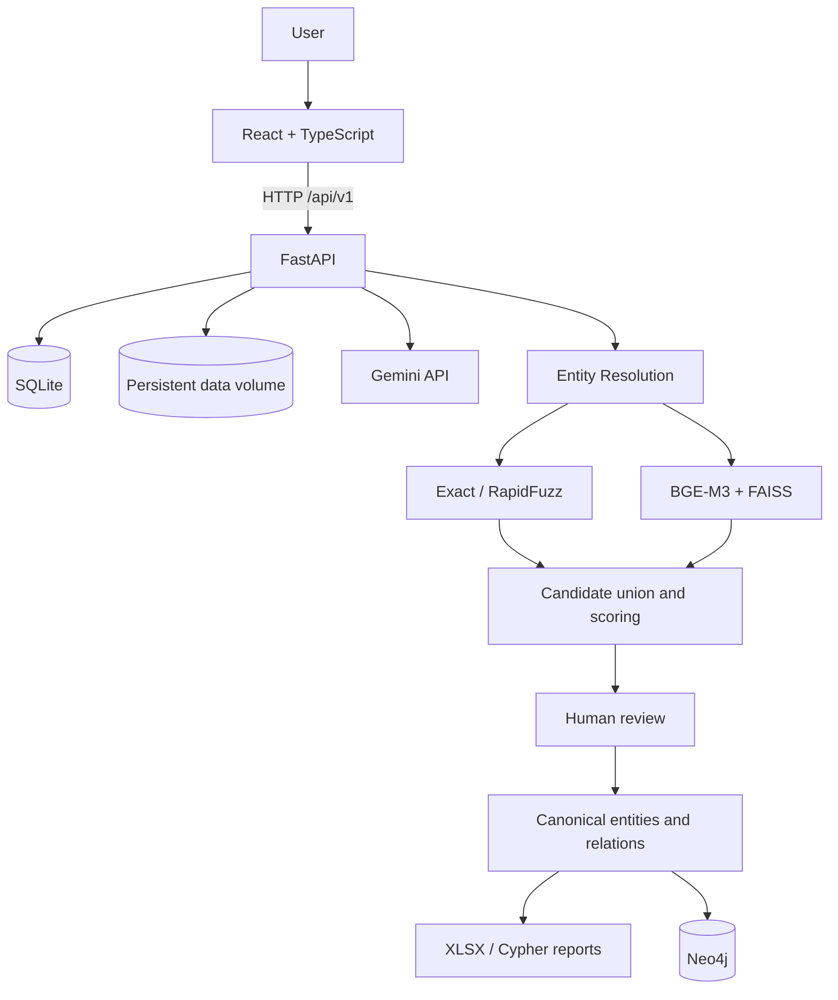

### Processing flow

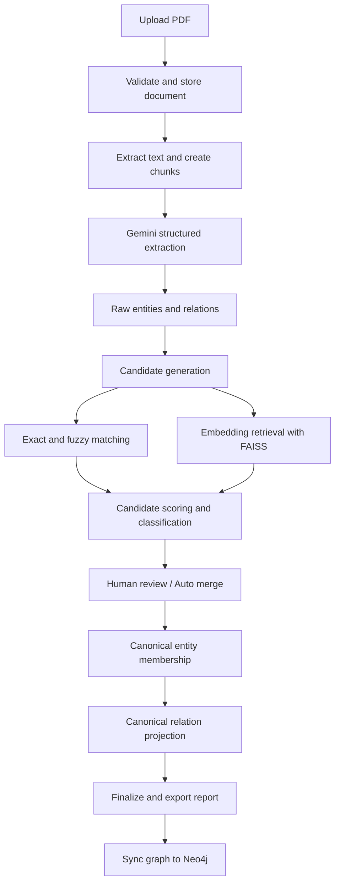

### Important design decisions

- **Raw/canonical separation:** source extraction is retained; ER creates a canonical representation rather than overwriting raw records.
- **Document isolation:** a document has its own ER run and graph scope. Cross-document entity resolution is not implemented.
- **Hybrid candidate generation:** string and semantic retrieval complement one another; similarity scores are heuristics, not calibrated probabilities.
- **Human control:** uncertain pairs are reviewable; Keep Separate is a constraint against future conflicting merges.
- **Transactional graph sync:** graph replacement is scoped to a document ID, so syncing one document should not delete other documents' graph data.
- **Relational and graph stores have different roles:** SQLite stores application state, provenance, and workflow decisions; Neo4j stores the resulting graph.

## 6. Getting started

### Option A — Docker Compose (recommended)

**Prerequisites**
- Docker Desktop (Windows/macOS) or Docker Engine + Docker Compose plugin (Linux).
- At least 8 GB RAM recommended; more memory is helpful for BGE-M3 and PyTorch.
- A Gemini API key to run LLM extraction. Uploading and inspecting existing records does not require a new extraction call.

#### 1. Clone the project

```bash
git clone https://github.com/pmhieu2193/text_to_graph.git
cd text_to_graph
```

#### 2. Create environment configuration

Windows PowerShell:

```powershell
Copy-Item .env.example .env
notepad .env
```

Linux/macOS:

```bash
cp .env.example .env
```

Set at least these values in `.env`. `BGE_MODEL_ID` selects the Hugging Face model repository downloaded during the backend image build; leave it as `BAAI/bge-m3` unless intentionally switching models:

```dotenv
NEO4J_PASSWORD=replace_with_a_strong_password
LLM_API_KEY=your_gemini_api_key
APP_PORT=8080
BGE_MODEL_ID=BAAI/bge-m3
```

Use a Neo4j password that satisfies Neo4j's password requirements. Do not commit `.env` or real credentials.

#### 3. Build and start the stack

```bash
docker compose up -d --build
```

The first build can take significantly longer: Docker installs the PyTorch/ML dependencies and downloads the complete BGE-M3 model into the backend image. Entity Resolution does not need to download model files at runtime. The model is loaded from `/opt/models/bge-m3` using the same `BGEM3FlagModel(..., use_fp16=False)` initialization as the application code.

Check container status:

```bash
docker compose ps
docker compose logs -f backend
```

#### 4. Open the application

| Service | URL |
|---|---|
| Web application | http://localhost:8080 |
| FastAPI Swagger UI | http://localhost:8000/docs |
| FastAPI health check | http://localhost:8000/health |
| Neo4j Browser | http://localhost:7474 |
| Neo4j Bolt | bolt://localhost:7687 |

Neo4j Browser credentials: username `neo4j` and the `NEO4J_PASSWORD` value from `.env`.

The frontend uses Nginx to proxy `/api/` requests to FastAPI. The browser does not need a separate backend URL configuration.

#### 5. Configure Gemini

You can provide `LLM_API_KEY` in `.env`, or configure the provider/model and API key in the application's Settings page. Settings saved through the UI are persisted in `data/settings.json` and override the environment fallback after restart.

The current implementation supports Gemini. Other LLM providers are future work.

### Persistent data

The following data survives container recreation and image rebuilds:

| Host path / Docker volume | Contents |
|---|---|
| `./data/` | SQLite database, uploaded PDFs, settings, FAISS indexes, reports |
| `neo4j_data` | Neo4j graph database |
| `neo4j_logs` | Neo4j logs |

Typical application data layout:

```text
data/
├── app.db
├── settings.json
├── documents/
├── extracted/
└── entity_resolution/
    ├── indexes/
    └── reports/
```

**Safe stop / restart:**

```bash
docker compose down
docker compose up -d
```

This keeps named volumes and the host `data/` directory.

**Warning:** `docker compose down -v` deletes named volumes, including the Neo4j database. The BGE-M3 model is part of the backend image, not a persistent volume; rebuilding the backend image downloads it again when the build cache does not contain that layer. Back up `data/` and the Neo4j volume before migrations or destructive maintenance.

### Option B — Run locally without Docker

Requirements: Python 3.11+, Node.js 20+, npm, and a Neo4j 5 instance.

Backend:

```bash
python -m venv .venv
# Windows: .venv\\Scripts\\activate
# Linux/macOS: source .venv/bin/activate
python -m pip install --upgrade pip
pip install -r requirements.txt
cp .env.example .env
alembic upgrade head
uvicorn app.main:app --reload
```

Frontend in a second terminal:

```bash
cd frontend
npm ci
npm run dev
```

For local development, the frontend defaults to `http://127.0.0.1:8000/api/v1`. Configure `frontend/.env` if the backend runs elsewhere.

## 7. API overview

Base path: `/api/v1`

| Method | Endpoint | Purpose |
|---|---|---|
| POST | `/documents/upload` | Upload a PDF |
| GET | `/documents` | List documents |
| GET | `/documents/{document_id}` | Get document details |
| POST | `/documents/{document_id}/quick-process` | Process, extract, and prepare ER in one workflow |
| POST | `/documents/{document_id}/process` | Extract text and create chunks |
| GET | `/documents/{document_id}/chunks` | List chunks |
| POST | `/documents/{document_id}/extract` | Run LLM extraction |
| GET | `/documents/{document_id}/result` | Read raw extraction results |
| POST | `/documents/{document_id}/entity-resolution/preview` | Generate ER candidates |
| GET | `/documents/{document_id}/entity-resolution/candidates` | List/filter/page candidates |
| POST | `/documents/{document_id}/entity-resolution/candidates/{pair_id}/decision` | Save a review decision |
| POST | `/documents/{document_id}/entity-resolution/auto-merge` | Merge eligible candidates |
| POST | `/documents/{document_id}/entity-resolution/finalize` | Finalize canonical data |
| GET | `/documents/{document_id}/entity-resolution/canonical-entities` | Read canonical entities |
| GET | `/documents/{document_id}/entity-resolution/canonical-relations` | Read canonical relations |
| POST | `/documents/{document_id}/entity-resolution/sync-neo4j` | Synchronize graph to Neo4j |
| DELETE | `/documents/{document_id}/entity-resolution/reset` | Reset ER state for rerun |
| GET / PUT | `/settings` | Read/update runtime settings |

See the interactive OpenAPI documentation at `/docs` for request schemas, response models, and validation details.

## 8. Project structure

```text
text_to_graph/
├── app/
│   ├── api/v1/routes/       # FastAPI route handlers
│   ├── core/                # Settings, database engine, dependencies
│   ├── models/              # SQLAlchemy models
│   ├── providers/llm/       # LLM provider integration
│   ├── repositories/        # Data access layer
│   ├── schemas/             # Pydantic request/response schemas
│   └── services/
│       ├── entity_resolution/ # Matching, merge, reports, Neo4j sync
│       ├── document_service.py
│       ├── extraction_service.py
│       ├── processing_service.py
│       ├── pdf_extractor.py
│       └── text_chunker.py
├── alembic/                 # Versioned database migrations
├── data/                    # Runtime data (not committed)
├── frontend/
│   ├── src/                 # React application
│   ├── Dockerfile
│   └── nginx.conf
├── tests/                   # Automated tests
├── Dockerfile               # FastAPI image
├── docker-compose.yml       # Frontend + backend + Neo4j
├── requirements.txt
└── README.md
```

## 9. Testing and quality

Run backend tests locally:

```bash
pytest -q
```

Build the frontend:

```bash
cd frontend
npm ci
npm run build
```

The test suite includes coverage for core matching/ER services and selected API workflows, database behavior, settings, and graph synchronization using test doubles where appropriate. A passing mocked Neo4j test does not replace a smoke test against a real Neo4j instance.

Before a release, verify:
- Alembic can upgrade a clean database to the current head.
- Upload, processing, extraction, ER preview, review, finalize, and Neo4j sync work end-to-end.
- A rerun does not delete raw extraction records.
- Restarting/rebuilding containers preserves application and graph data.
- The frontend production build succeeds.

## 10. Limitations and roadmap

This is a portfolio-scale MVP, not a production multi-tenant service. Current limitations:

- Gemini is the only supported LLM provider.
- ER runs within a single document; cross-document entity resolution is not implemented.
- One current ER run is maintained per document; parallel/versioned canonical snapshots are not supported.
- Candidate retrieval is top-K based and can miss valid pairs.
- Similarity thresholds are heuristic and have not been calibrated as probabilities on a large, independently labeled benchmark.
- BGE-M3/PyTorch can require substantial memory and CPU time; the model download increases the initial backend image build time and image size.
- SQLite is suitable for this single-instance MVP; high write concurrency and multi-worker scaling need a different deployment design.
- Authentication, authorization, multi-user audit ownership, rate limiting, and production secret management are not yet implemented.
- Long-running extraction and embedding work is currently handled by the application workflow rather than a dedicated distributed job queue.

### Roadmap

| Priority | Planned improvement |
|---|---|
| High | Add a labeled Vietnamese ER benchmark and report precision, recall, F1, pairwise metrics, and latency |
| High | Add authentication, authorization, and per-user document access |
| High | Add background jobs, progress tracking, retry policies, and cancellation |
| Medium | Add PostgreSQL for concurrent relational workloads |
| Medium | Add Redis for caching, task coordination, and job queue support |
| Medium | Add provider abstraction for additional LLM vendors |
| Medium | Improve observability with structured logs and pipeline metrics |
| Later | Support cross-document entity resolution and versioned ER runs |
| Later | Add CI pipeline for linting, tests, frontend build, and Docker image validation |

## 11. Ownership and credits

**Primary implementation by the project author:**
- Backend architecture and Python implementation.
- FastAPI endpoints, request/response schemas, and database models.
- Document processing and LLM extraction workflow.
- Entity-resolution candidate generation, matching, merge rules, and canonicalization.
- Neo4j graph synchronization and persistence design.
- Docker deployment configuration, integration, and backend testing.

**Frontend:** the React/TypeScript interface was developed with AI assistance. The project author integrated it with the backend APIs and is responsible for reviewing and maintaining the overall application.

**Third-party components:** Google Gemini, BAAI BGE-M3, FastAPI, SQLAlchemy, Alembic, RapidFuzz, FAISS, Neo4j, React, and other dependencies remain the property of their respective authors and are used under their licenses.

## 12. Security notes

- Never commit `.env`, API keys, passwords, private PDFs, or generated runtime data.
- `data/settings.json` stores runtime secrets in plaintext. Protect the host directory and do not expose the Settings API publicly without authentication.
- The current API is intended for local/demo use; it does not provide user authentication or authorization.
- Change the sample Neo4j password before starting the stack.
- Do not expose Neo4j ports or the backend API directly to the public Internet without access controls, TLS, and deployment hardening.
- Only upload documents that you have permission to process.

---

*Built as a practical portfolio project demonstrating Python backend engineering, LLM-assisted information extraction, entity resolution, relational data modeling, and graph database integration.*
