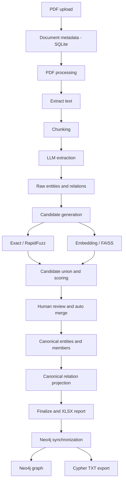
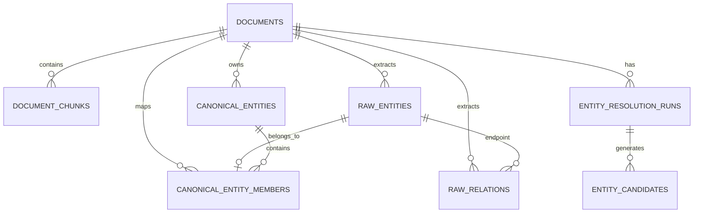

# Vietnamese PDF to Knowledge Graph

Ứng dụng backend xây dựng **Knowledge Graph tiếng Việt từ tài liệu PDF phi cấu trúc**. Hệ thống tiếp nhận PDF, trích xuất văn bản, chia chunk, dùng LLM trích xuất thực thể và quan hệ, thực hiện Entity Resolution (ER) có hỗ trợ con người (Human-in-the-Loop), sau đó đồng bộ đồ thị canonical sang Neo4j.

Dự án tập trung vào tính đúng đắn dữ liệu, khả năng truy vết nguồn, kiểm soát thao tác merge và khả năng chạy lại từng tài liệu độc lập.

## 1. Mục tiêu và phạm vi

### Mục tiêu chính

- Chuyển tài liệu PDF tiếng Việt thành dữ liệu thực thể - quan hệ có cấu trúc.
- Giữ nguyên dữ liệu trích xuất ban đầu để bảo toàn provenance.
- Phát hiện các thực thể có khả năng cùng chỉ một đối tượng bằng kết hợp so khớp chuỗi và embedding.
- Cho phép người dùng duyệt và quyết định các cặp chưa chắc chắn.
- Hợp nhất thành canonical entities, kế thừa và khử trùng lặp quan hệ.
- Đồng bộ từng document sang Neo4j và xuất Cypher để kiểm tra/tái sử dụng.
- Có migration, API response schema và automated tests cho các nghiệp vụ quan trọng.

### Phạm vi MVP

- Mỗi lần upload tạo một `document_id` mới. Hai file có cùng nội dung vẫn là hai document độc lập; hệ thống không tự động gộp theo SHA-256.
- Mỗi document chỉ có **một ER run hiện hành tại một thời điểm**. Muốn chạy ER lại phải reset ER trước.
- Entity Resolution chỉ diễn ra trong phạm vi một document, không merge entity giữa các PDF.
- SQLite là database mặc định; Neo4j là graph store đích.
- BGE-M3/FAISS được dùng để tạo ứng viên embedding. RapidFuzz tạo ứng viên theo độ tương đồng chuỗi.
- Không có cam kết rằng similarity score là xác suất hai thực thể đồng nhất. Các ngưỡng hiện tại là cấu hình heuristic và cần đánh giá trên tập dữ liệu gán nhãn.

## 2. Kiến trúc tổng quan



### Thành phần

| Thành phần | Trách nhiệm |
|---|---|
| FastAPI | REST API, dependency injection, validation và OpenAPI |
| SQLAlchemy 2.x | ORM và transaction với SQLite |
| Alembic | Quản lý phiên bản schema database |
| PyMuPDF | Đọc nội dung PDF |
| TextChunker | Chia văn bản thành các chunk có overlap |
| Gemini | Trích xuất entities/relations theo JSON schema |
| RapidFuzz | Sinh candidate dựa trên độ tương đồng chuỗi |
| BGE-M3 + FAISS | Embedding và tìm kiếm candidate ngữ nghĩa |
| pandas + openpyxl | Báo cáo preview/finalize dạng XLSX |
| Neo4j Python Driver | Đồng bộ canonical graph sang Neo4j |
| pytest | Unit test và integration-style test với dependency giả lập |

## 3. Luồng nghiệp vụ

### 3.1 Upload và xử lý PDF

1. Client upload file PDF.
2. Backend kiểm tra phần mở rộng, chữ ký PDF và giới hạn dung lượng.
3. File được lưu với tên nội bộ theo UUID; metadata và SHA-256 được lưu trong SQLite.
4. PDF được trích xuất text và chia chunk.
5. Chunk cùng metadata trang được lưu để phục vụ extraction và truy vết.

### 3.2 LLM extraction

LLM nhận từng chunk và trả về danh sách:

- **Entity:** `local_id`, `name`, `aliases`, `entity_type`, `description`, `evidence`, `confidence`.
- **Relation:** `local_id`, `subject_local_id`, `object_local_id`, `relation_type`, `description`, `evidence`, `confidence`.

Các bản ghi được lưu ở `raw_entities` và `raw_relations`. Đây là dữ liệu nguồn, không bị ghi đè khi ER merge.

Nếu document đã có ER run/canonical mapping, API chặn xử lý PDF hoặc extraction lại trên chính document đó. Điều này bảo vệ các raw IDs đang được candidate và canonical membership tham chiếu. Upload cùng một PDF thành document mới vẫn được phép vì document ID khác nhau.

### 3.3 Entity Resolution

ER preview thực hiện các bước:

1. Nạp raw entities thuộc document.
2. Chuẩn hóa dữ liệu entity phục vụ matching.
3. Sinh candidate từ string matcher và embedding matcher.
4. Hợp nhất tập candidate, lưu score, phương pháp match và evidence snapshot.
5. Phân loại candidate thành `AUTO_MERGE`, `REVIEW` hoặc `REJECT`.
6. Khởi tạo canonical entity cho mỗi raw entity và tạo mapping trong `canonical_entity_members`.
7. Lưu ER run và báo cáo preview.

Điểm hybrid hiện tại khi có đủ hai score:

`final_score = 0.45 × fuzzy_score + 0.55 × embedding_score`

Nếu chỉ có một loại score, `final_score` để `null`; `match_method` thể hiện nguồn score. Điểm số là similarity heuristic, không phải xác suất.

### 3.4 Human-in-the-Loop và merge

Người dùng có thể quyết định candidate:

- `MERGE`: gộp hai canonical clusters.
- `KEEP_SEPARATE`: ghi nhận hai raw entities không được gộp qua candidate đó.
- `SKIP`: bỏ qua candidate mà không khẳng định hai thực thể khác nhau.

Auto merge chỉ xử lý candidate đang `PENDING` và được phân loại `AUTO_MERGE`. Candidate được xử lý tuần tự; mỗi lần merge sẽ tra canonical cluster hiện tại của raw IDs. Vì vậy chuỗi A-B, B-C có thể hợp nhất thành một cluster A-B-C.

Trong giao diện Human Review, tùy chọn **Auto-merge before Finalize** được bật mặc định. Nhấn **Next: Finalize** sẽ chạy auto-merge trước rồi finalize ngay trong cùng thao tác; người dùng không phải duyệt hết candidate. Có thể bỏ chọn nếu muốn không chạy auto-merge. Các candidate vẫn `PENDING` sau đó sẽ được ghi nhận `SKIP/SKIPPED`, không bị hiểu là hai thực thể khác nhau. Các quyết định MERGE/KEEP_SEPARATE/SKIP người dùng đã thực hiện được giữ nguyên.

Merge không xóa raw entities/relations. Membership của các raw entity được chuyển sang canonical survivor; canonical thua cuộc được đánh dấu bằng `merged_into_id`. Merge khác entity type hoặc vi phạm quyết định KEEP_SEPARATE sẽ bị chặn.

### 3.5 Finalize và canonical graph

Finalize là bước đóng ER run:

- Khi `auto_merge=true` (mặc định), áp dụng các AUTO_MERGE candidate còn PENDING. Khi `auto_merge=false`, không tự động merge.
- Giữ nguyên các quyết định reviewer đã thực hiện.
- Candidate PENDING còn lại chuyển thành `SKIP/SKIPPED`, không tự hiểu là hai entity khác nhau.
- Tái tạo aliases từ tên và aliases của các raw members.
- Chiếu raw relations sang canonical endpoints.
- Gộp cạnh trùng theo subject canonical, object canonical và relation type chuẩn hóa.
- Bỏ self-loop khỏi graph view nếu hai đầu cạnh đã merge thành cùng canonical entity. Raw relation vẫn được bảo toàn.
- Xuất XLSX gồm Summary, Candidates, Canonical_Entities và Canonical_Relations.

Node độc lập (không có cạnh) vẫn được giữ nếu được trích xuất hợp lệ từ văn bản. Hệ thống không tạo cạnh giả chỉ để làm đồ thị liên thông.

### 3.6 Neo4j synchronization

Chỉ document đã FINALIZED mới được sync.

Trước khi ghi Neo4j, backend kiểm tra:

- Canonical membership bao phủ chính xác tập raw entities của document, không trùng và không thiếu.
- Mọi canonical relation có đủ hai endpoint.
- Số raw relations được biểu diễn bởi canonical edges cộng self-loops bị loại khỏi graph view bằng số raw relations nguồn.

Sync thay thế graph thuộc đúng `document_id` trong một Neo4j write transaction, không xóa graph của document khác. Node sử dụng label `Entity`. Relationship type trong Neo4j được lấy từ domain `relation_type`, chuẩn hóa thành chữ hoa và dấu gạch dưới (ví dụ `located in` → `LOCATED_IN`). Thuộc tính `relation_type` vẫn lưu giá trị nguồn. Backend tạo query riêng theo từng relationship type bằng Cypher chuẩn; không yêu cầu cài APOC plugin.

Sau khi sync thành công, file Cypher được xuất tại:

`data/entity_resolution/reports/neo4j_sync_<document_id>.cypher.txt`

File chứa lệnh xóa và dựng lại graph của đúng document, có thể mở bằng Neo4j Browser/Neo4j Cypher Shell để kiểm tra hoặc chạy lại. Chỉ dùng file với database/schema tương thích và kiểm tra `document_id` trước khi chạy. Không chạy file nếu không muốn thay thế graph hiện tại của document đó.

## 4. Mô hình dữ liệu



| Bảng | Ý nghĩa |
|---|---|
| `documents` | Metadata file và trạng thái xử lý |
| `document_chunks` | Các đoạn văn bản nguồn |
| `chunk_extraction_runs` | Trạng thái extraction theo chunk |
| `raw_entities` | Thực thể nguyên bản do LLM trích xuất |
| `raw_relations` | Quan hệ nguyên bản do LLM trích xuất |
| `entity_resolution_runs` | Trạng thái ER và Neo4j sync của document |
| `entity_candidates` | Cặp candidate, scores, evidence snapshot và quyết định |
| `canonical_entities` | Các thực thể đại diện sau chuẩn hóa/merge |
| `canonical_entity_members` | Ánh xạ một raw entity vào một canonical cluster |

**Vì sao vẫn lưu `run_id` trong database?** API public lấy run hiện hành theo `document_id`, nhưng run ID vẫn là khóa liên kết nội bộ cho candidate và audit. Nó không còn là tham số đầu vào của các thao tác candidates, auto-merge, finalize hoặc sync.

## 5. REST API

Base URL: `/api/v1`

Swagger UI: `http://127.0.0.1:8000/docs`

| Method | Endpoint | Mô tả |
|---|---|---|
| POST | `/documents/upload` | Upload PDF |\n| POST | `/documents/{document_id}/quick-process` | Process PDF, extract entities/relations and create ER candidates, then stop at Human Review |\n| DELETE | `/documents/{document_id}` | Delete document, all local artifacts and optionally its Neo4j graph (`?keep_neo4j=true`) |
| GET | `/documents` | Danh sách document có phân trang |
| GET | `/documents/{document_id}` | Chi tiết document |\n| GET | `/settings` | Read runtime LLM/Neo4j settings (secrets masked) |\n| PUT | `/settings` | Update runtime settings in `data/settings.json` |
| POST | `/documents/{document_id}/process` | Trích xuất text và chunk PDF |
| GET | `/documents/{document_id}/chunks` | Danh sách chunks |
| POST | `/documents/{document_id}/extract` | LLM extraction; hỗ trợ `?force=true` |
| GET | `/documents/{document_id}/result` | Kết quả raw entities/relations |
| POST | `/documents/{document_id}/entity-resolution/preview` | Sinh ER candidates và báo cáo |
| GET | `/documents/{document_id}/entity-resolution/candidates` | Lấy candidate của ER run hiện hành |
| POST | `/documents/{document_id}/entity-resolution/candidates/{pair_id}/decision` | Quyết định một candidate |
| POST | `/documents/{document_id}/entity-resolution/auto-merge` | Merge AUTO_MERGE candidates |
| POST | `/documents/{document_id}/entity-resolution/finalize` | Finalize ER; query `auto_merge=true|false` (mặc định `true`) |
| GET | `/documents/{document_id}/entity-resolution/canonical-entities` | Lấy canonical entities |
| GET | `/documents/{document_id}/entity-resolution/canonical-relations` | Lấy canonical relations |
| POST | `/documents/{document_id}/entity-resolution/sync-neo4j` | Sync canonical graph |
| DELETE | `/documents/{document_id}/neo4j-graph` | Xóa graph của một document trong Neo4j |
| DELETE | `/documents/{document_id}/entity-resolution/reset` | Reset dữ liệu ER trong SQLite |

### Ví dụ quyết định candidate

```http
POST /api/v1/documents/<document_id>/entity-resolution/candidates/<pair_id>/decision
Content-Type: application/json
```

```json
{"decision": "MERGE"}
```

Các giá trị hợp lệ: `MERGE`, `KEEP_SEPARATE`, `SKIP`.

### Ví dụ luồng ER đến Neo4j

```text
POST /documents/{id}/entity-resolution/preview
GET  /documents/{id}/entity-resolution/candidates
POST /documents/{id}/entity-resolution/candidates/{pair_id}/decision
POST /documents/{id}/entity-resolution/auto-merge
POST /documents/{id}/entity-resolution/finalize?auto_merge=true
GET  /documents/{id}/entity-resolution/canonical-entities
GET  /documents/{id}/entity-resolution/canonical-relations
POST /documents/{id}/entity-resolution/sync-neo4j
```

Các API ER không nhận `run_id` trong URL. Response vẫn trả `run_id` để trace và hỗ trợ debug.

Các endpoint document cũ có prefix lặp `/api/v1/documents/documents/...` vẫn được giữ dưới dạng alias tương thích ngược; nên dùng các đường dẫn chuẩn trong bảng trên cho client mới.

## 6. Persistent data và runtime settings

Toàn bộ dữ liệu runtime nằm dưới `data/` để có thể mount thành Docker volume:

```text
data/
├── app.db
├── settings.json                 # API keys và Neo4j connection (không commit)
├── documents/                    # PDF gốc
├── extracted/                    # Legacy extracted text; chunk mới lưu trong SQLite
└── entity_resolution/
    ├── indexes/                  # FAISS .index và .meta.json
    └── reports/                  # XLSX và Cypher TXT
```

Khi khởi động, ứng dụng tự chuyển các artifact cũ từ `storage/` vào vị trí tương ứng trong `data/` nếu đích chưa tồn tại. Đường dẫn document cũ trong SQLite vẫn được resolve trong giai đoạn chuyển đổi. Không xóa `data/` khi cập nhật image hoặc source code.

API `GET/PUT /api/v1/settings` đọc và cập nhật cấu hình LLM/Neo4j. Secret chỉ được trả về dưới dạng trạng thái đã cấu hình, không trả plaintext. File `data/settings.json` chứa secret dạng plaintext nên chỉ dùng trên máy đáng tin cậy; khi triển khai Docker, mount volume với quyền truy cập hạn chế và không public endpoint settings ra Internet nếu chưa có authentication.

## 7. Cài đặt và chạy local

### Yêu cầu

- Python 3.11+ (khuyến nghị).
- SQLite.
- Gemini API key để chạy extraction.
- Neo4j 5.x nếu sử dụng chức năng sync.
- RAM/CPU đủ để tải embedding model BGE-M3; lần chạy đầu có thể tải model về cache.

### Tạo môi trường

Windows PowerShell:

```powershell
py -3.11 -m venv .venv
.\.venv\Scripts\Activate.ps1
python -m pip install --upgrade pip
pip install -r requirements.txt
Copy-Item .env.example .env
```

Linux/macOS:

```bash
python3.11 -m venv .venv
source .venv/bin/activate
python -m pip install --upgrade pip
pip install -r requirements.txt
cp .env.example .env
```

Cập nhật `.env`:

```dotenv
DATABASE_URL=sqlite:///./data/app.db
LLM_PROVIDER=gemini
LLM_MODEL=gemini-2.5-flash
LLM_API_KEY=your_gemini_api_key

ER_EMBEDDING_MODEL=BAAI/bge-m3
ER_REPORT_FORMAT=xlsx

NEO4J_URI=bolt://localhost:7687
NEO4J_USERNAME=neo4j
NEO4J_PASSWORD=your_neo4j_password
NEO4J_DATABASE=neo4j
```

Không commit file `.env` hoặc secrets lên Git.

### Database migration

Ứng dụng không tự chạy `create_all()` khi startup. Alembic là nguồn quản lý schema.

Sao lưu database trước khi migrate:

```powershell
Copy-Item .\data\app.db .\data\app_backup.db
```

Áp dụng migration:

```bash
alembic current
alembic upgrade head
alembic current
```

Xem lịch sử:

```bash
alembic history
```

Tạo migration khi thay đổi ORM model:

```bash
alembic revision --autogenerate -m "describe schema change"
```

Luôn review file migration được sinh tự động trước khi áp dụng. Không sửa migration đã được triển khai; tạo revision mới. Với database cũ, kiểm tra đúng `DATABASE_URL` trước khi chạy migration để tránh cập nhật nhầm database.

### Start API

```bash
uvicorn app.main:app --reload
```

- API: `http://127.0.0.1:8000`
- Swagger: `http://127.0.0.1:8000/docs`
- Health: `http://127.0.0.1:8000/health`

### Start frontend

Mở terminal thứ hai, từ thư mục gốc repository:

```powershell
cd frontend
npm install
npm run dev
```

Mở URL Vite hiển thị trong terminal (mặc định `http://localhost:5173`). Frontend gọi API tại `http://127.0.0.1:8000/api/v1` theo mặc định. Nếu API chạy ở địa chỉ khác, tạo `frontend/.env` với:

```dotenv
VITE_API_BASE_URL=http://127.0.0.1:8000/api/v1
```

Khởi động backend và frontend trong hai terminal riêng. CORS mặc định cho phép `localhost:5173` và `127.0.0.1:5173`.

## 8. Cấu hình chính

| Biến | Mặc định / ý nghĩa |
|---|---|
| `DATABASE_URL` | `sqlite:///./data/app.db` |
| `STORAGE_DIR` | Thư mục lưu PDF |
| `MAX_UPLOAD_SIZE_MB` | Giới hạn kích thước PDF |
| `CHUNK_SIZE` / `CHUNK_OVERLAP` | Kích thước và overlap khi chia chunk |
| `LLM_PROVIDER` | Provider LLM, hiện cấu hình Gemini |
| `LLM_MODEL` | Model dùng cho extraction |
| `LLM_API_KEY` | Gemini API key chính |
| `LLM_FALLBACK_API_KEY` | API key dự phòng |
| `ER_INDEX_DIR` | Thư mục FAISS index và metadata |
| `ER_EMBEDDING_MODEL` | Model embedding, mặc định BGE-M3 |
| `ER_FAISS_TOP_K` | Số kết quả FAISS truy xuất |
| `ER_EMBEDDING_CANDIDATE_LIMIT` | Giới hạn candidate embedding |
| `ER_STRING_TOP_K` | Giới hạn candidate từ string matcher |
| `ER_FUZZY_AUTO_THRESHOLD` | Ngưỡng fuzzy cho auto merge |
| `ER_EMBEDDING_AUTO_THRESHOLD` | Ngưỡng embedding cho auto merge |
| `ER_FUZZY_REVIEW_THRESHOLD` | Ngưỡng fuzzy đưa vào review |
| `ER_EMBEDDING_REVIEW_THRESHOLD` | Ngưỡng embedding đưa vào review |
| `ER_AUTO_MERGE_EXACT` | Có cho phép exact match auto merge hay không |
| `ER_REPORT_DIR` | Thư mục XLSX và Cypher TXT |
| `NEO4J_URI` | Bolt URI của Neo4j |
| `NEO4J_USERNAME` / `NEO4J_PASSWORD` | Neo4j credentials |
| `NEO4J_DATABASE` | Database đích |

## 9. Reset và chạy lại

### Reset Entity Resolution

`DELETE /api/v1/documents/{document_id}/entity-resolution/reset`

Reset chỉ xóa ER-dependent records:

- `entity_candidates`
- `canonical_entity_members`
- `canonical_entities`
- `entity_resolution_runs`

Reset **giữ lại**:

- PDF và document metadata.
- `document_chunks`.
- `raw_entities`, `raw_relations`.
- `chunk_extraction_runs`.
- FAISS `.index` và `.meta.json`.
- Các file báo cáo đã xuất.

Nếu graph đã sync hoặc đang ở trạng thái sync khác `NOT_SYNCED`, cần xóa graph của document khỏi Neo4j trước rồi mới reset.

### Chạy lại PDF processing/extraction

ER reset không xóa raw extraction. Vì vậy nếu mục đích là thay đổi nội dung chunk hoặc tạo lại raw IDs, cần có quy trình reset extraction riêng; không nên hiểu ER reset là xóa toàn bộ pipeline. Hiện tại processing/extraction được chặn khi ER run/canonical mapping còn tồn tại để tránh phá vỡ các tham chiếu.

## 10. Kiểm thử

Cài dependencies rồi chạy:

```bash
pytest -q
```

Các test trọng tâm bao gồm:

- String matcher và embedding matcher.
- Candidate generation, hybrid scoring và classification.
- Transitive merge A-B-C.
- Giữ nguyên raw entities/relations và kiểm tra canonical membership.
- KEEP_SEPARATE conflict và quyết định reviewer.
- Finalize, mặc định candidate chưa review thành SKIP, xuất workbook.
- Alias aggregation và canonical relation deduplication.
- Reset ER và khả năng tạo run mới.
- Neo4j sync bằng driver giả lập, kiểm tra relationship types và Cypher export.
- API route document-scoped và response model.

Các test Neo4j dùng fake driver nên không cần Neo4j server. Nên chạy thêm smoke test thủ công với một Neo4j instance thực tế trước khi triển khai.

## 11. Các giới hạn hiện tại và hướng phát triển

- Mỗi document chỉ có một ER run hiện hành; chưa hỗ trợ lưu nhiều phiên bản canonical snapshot song song.
- ER được giới hạn trong document; chưa có cross-document entity resolution.
- Candidate generation có thể bỏ sót cặp vì phụ thuộc top-K/blocking.
- Threshold chưa được hiệu chỉnh bằng benchmark gán nhãn đủ lớn.
- Không tự động tạo quan hệ để kết nối isolated nodes; node cô lập vẫn hợp lệ nếu có căn cứ trong nguồn.
- Chưa thiết kế cho workload sync đồng thời quy mô lớn; trạng thái sync hiện phù hợp với ứng dụng MVP chạy một worker.
- Neo4j graph sync hiện thay thế graph theo document, không phải incremental sync.

Hướng phát triển hợp lý: bộ dữ liệu đánh giá ER có nhãn, đo precision/recall theo từng loại entity, versioning extraction, incremental sync, frontend review workflow và quan sát pipeline qua structured logging.

## 12. Cấu trúc thư mục

```text
app/
├── api/v1/routes/          # FastAPI endpoints
├── core/                   # Settings, database session
├── models/                 # SQLAlchemy ORM models
├── providers/llm/          # LLM provider abstraction and Gemini
├── repositories/           # Database access for documents/extraction
├── schemas/                # Pydantic request/response schemas
└── services/
    ├── entity_resolution/  # Matching, merge, reports, Neo4j sync
    ├── document_service.py
    ├── processing_service.py
    ├── extraction_service.py
    ├── pdf_extractor.py
    └── text_chunker.py
alembic/
└── versions/               # Versioned database migrations
scripts/                    # Matcher benchmarks and experiments
tests/                      # Automated tests
storage/                    # Local PDFs, FAISS indexes and reports
```

## 13. Dữ liệu và bảo mật

Chỉ sử dụng tài liệu mà bạn có quyền xử lý. API key, database credentials và dữ liệu PDF thực tế không nên đưa vào repository công khai. Kiểm tra `.gitignore` và nội dung commit trước khi push.
