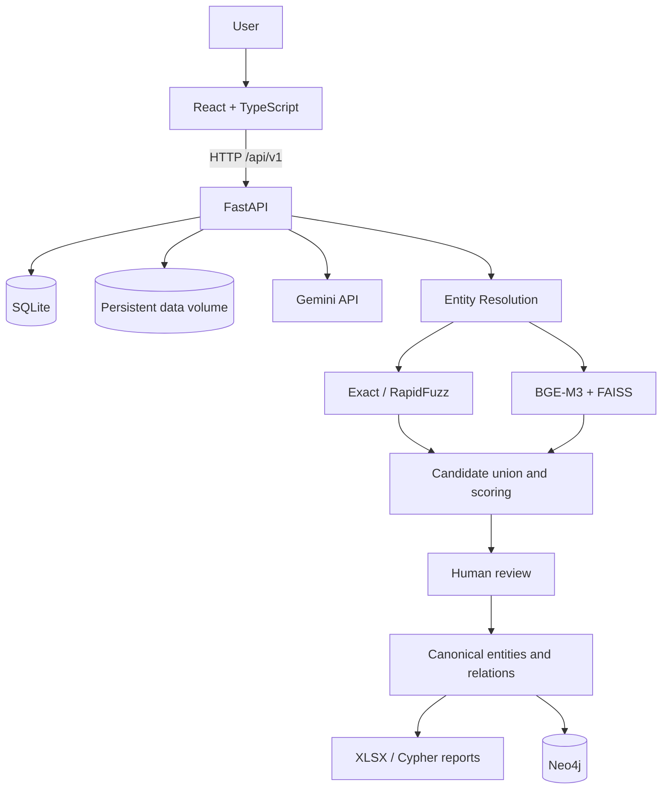
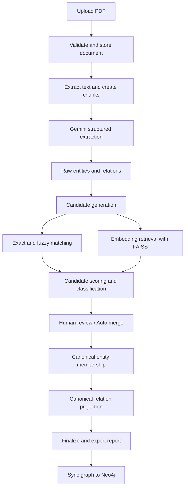

# VietGraph — Vietnamese PDF to Knowledge Graph

> Turn unstructured Vietnamese PDF documents into traceable knowledge graphs with Gemini extraction, hybrid entity matching, human review, and Neo4j.

VietGraph is a full-stack application for extracting entities and relationships from Vietnamese PDF documents, resolving duplicate entity mentions, and publishing a canonical graph to Neo4j. It combines an LLM-based extraction pipeline with deterministic matching, embedding-based candidate retrieval, and a Human-in-the-Loop (HITL) review workflow.

**Project focus:** Python backend engineering, data modeling, API design, entity-resolution workflows, persistence, and graph database integration.

[Repository](https://github.com/pmhieu2193/text_to_graph) · [API documentation](http://localhost:8000/docs) · [Neo4j Browser](http://localhost:7474)

---

## 1. Project at a glance

| Item | Description |
|---|---|
| Project | VietGraph — Vietnamese PDF to Knowledge Graph |
| Problem | PDF extraction often produces duplicate, inconsistent entity names and noisy relationships |
| Solution | Extract raw entities/relations, generate duplicate candidates, review/merge them, and sync canonical data to Neo4j |
| Primary backend | Python, FastAPI, SQLAlchemy, Alembic |
| LLM | Google Gemini (currently the supported provider) |
| Entity matching | RapidFuzz + BGE-M3 embeddings + FAISS |
| Databases | SQLite for application/workflow data; Neo4j for graph storage |
| Frontend | React, TypeScript, Vite |
| Deployment | Docker Compose |

### Why this project?

A knowledge graph built directly from LLM output can contain duplicate nodes, inconsistent labels, and redundant edges. VietGraph separates **raw extraction** from **entity resolution** so that the original evidence remains available while canonical entities are reviewed and synchronized to a graph database.

## 2. Demo

Add project screenshots or a short walkthrough video here before sharing the repository with recruiters.

Suggested demo sequence:

1. Upload a Vietnamese PDF and run document processing.
2. Show extracted entities, aliases, relationships, and source evidence.
3. Open Entity Resolution and compare two candidate entities.
4. Review a candidate using Merge, Keep Separate, or Skip.
5. Finalize the canonical graph and inspect the summary metrics.
6. Synchronize the document graph and open it in Neo4j Browser.

Suggested assets:

- `docs/screenshots/01-dashboard.png`
- `docs/screenshots/02-document-details.png`
- `docs/screenshots/03-entity-review.png`
- `docs/screenshots/04-finalize-metrics.png`
- `docs/screenshots/05-neo4j-graph.png`
- YouTube demo: *add link*

## 3. Key features

### Document ingestion and extraction
- Upload and validate PDF documents.
- Extract text and split it into overlapping chunks.
- Keep document metadata, chunk content, and raw extraction records in the application database.
- Use Gemini to extract structured entities, aliases, and relationships from Vietnamese text.
- Preserve evidence and source references for traceability.

### Hybrid Entity Resolution
- Generate candidate pairs using exact/string matching and RapidFuzz.
- Generate semantic candidates with BGE-M3 embeddings and FAISS nearest-neighbor search.
- Combine available matching scores and classify candidates into automatic merge, manual review, or reject groups.
- Scope resolution to one document; independent documents do not share canonical entities.
- Retain raw entities and relations instead of destructively rewriting extraction output.

### Human-in-the-Loop review
- Compare candidate entities and their evidence side by side.
- Support `MERGE`, `KEEP_SEPARATE`, and `SKIP` decisions.
- Apply automatic merges to eligible candidates.
- Process transitive clusters such as A-B and B-C using current canonical membership.
- Prevent a merge that conflicts with a recorded Keep Separate decision.

### Canonical graph and Neo4j
- Build canonical entities and map raw entity records to canonical clusters.
- Aggregate entity names and aliases.
- Project raw relationships onto canonical endpoints.
- Deduplicate equivalent relationships and omit self-loops created by entity merging from the graph view.
- Export a final XLSX report and a Cypher synchronization artifact.
- Synchronize one document's graph without replacing other documents' graph data.

### Workflow and operations
- Document-scoped API endpoints with pagination and filtering.
- Runtime LLM and Neo4j settings, with secrets masked in API responses.
- Alembic database migrations.
- Reset and rerun Entity Resolution while preserving the source extraction layer.
- Dockerized frontend, backend, and Neo4j with persistent storage.

## 4. Tech stack

| Layer | Technologies |
|---|---|
| Backend/API | Python 3.11, FastAPI, Pydantic, Uvicorn |
| ORM and migrations | SQLAlchemy 2.x, Alembic |
| PDF processing | PyMuPDF |
| LLM extraction | Google Gemini via Google Gen AI SDK |
| String matching | RapidFuzz |
| Embeddings | BAAI BGE-M3, Sentence Transformers / FlagEmbedding |
| Vector retrieval | FAISS |
| Relational/workflow storage | SQLite |
| Graph database | Neo4j 5 Community, Neo4j Python Driver |
| Reports | pandas, openpyxl |
| Frontend | React 18, TypeScript, Vite, TanStack Query, Axios |
| Web serving | Nginx |
| Containers | Docker, Docker Compose |
| Testing | pytest, HTTPX |

## 5. Architecture

### High-level architecture



### Processing flow



### Important design decisions

- **Raw/canonical separation:** source extraction is retained; ER creates a canonical representation rather than overwriting raw records.
- **Document isolation:** a document has its own ER run and graph scope. Cross-document entity resolution is not implemented.
- **Hybrid candidate generation:** string and semantic retrieval complement one another; similarity scores are heuristics, not calibrated probabilities.
- **Human control:** uncertain pairs are reviewable; Keep Separate is a constraint against future conflicting merges.
- **Transactional graph sync:** graph replacement is scoped to a document ID, so syncing one document should not delete other documents' graph data.
- **Relational and graph stores have different roles:** SQLite stores application state, provenance, and workflow decisions; Neo4j stores the resulting graph.

## 6. Getting started

### Option A — Docker Compose (recommended)

**Prerequisites**
- Docker Desktop (Windows/macOS) or Docker Engine + Docker Compose plugin (Linux).
- At least 8 GB RAM recommended; more memory is helpful for BGE-M3 and PyTorch.
- A Gemini API key to run LLM extraction. Uploading and inspecting existing records does not require a new extraction call.

#### 1. Clone the project

```bash
git clone --branch feature/entity-resolution-hitl-alembic https://github.com/pmhieu2193/text_to_graph.git
cd text_to_graph
```

#### 2. Create environment configuration

Windows PowerShell:

```powershell
Copy-Item .env.example .env
notepad .env
```

Linux/macOS:

```bash
cp .env.example .env
```

Set at least these values in `.env`. `BGE_MODEL_ID` selects the Hugging Face model repository downloaded during the backend image build; leave it as `BAAI/bge-m3` unless intentionally switching models:

```dotenv
NEO4J_PASSWORD=replace_with_a_strong_password
LLM_API_KEY=your_gemini_api_key
APP_PORT=8080
BGE_MODEL_ID=BAAI/bge-m3
```

Use a Neo4j password that satisfies Neo4j's password requirements. Do not commit `.env` or real credentials.

#### 3. Build and start the stack

```bash
docker compose up -d --build
```

The first build can take significantly longer: Docker installs the PyTorch/ML dependencies and downloads the complete BGE-M3 model into the backend image. Entity Resolution does not need to download model files at runtime. The model is loaded from `/opt/models/bge-m3` using the same `BGEM3FlagModel(..., use_fp16=False)` initialization as the application code.

Check container status:

```bash
docker compose ps
docker compose logs -f backend
```

#### 4. Open the application

| Service | URL |
|---|---|
| Web application | http://localhost:8080 |
| FastAPI Swagger UI | http://localhost:8000/docs |
| FastAPI health check | http://localhost:8000/health |
| Neo4j Browser | http://localhost:7474 |
| Neo4j Bolt | bolt://localhost:7687 |

Neo4j Browser credentials: username `neo4j` and the `NEO4J_PASSWORD` value from `.env`.

The frontend uses Nginx to proxy `/api/` requests to FastAPI. The browser does not need a separate backend URL configuration.

#### 5. Configure Gemini

You can provide `LLM_API_KEY` in `.env`, or configure the provider/model and API key in the application's Settings page. Settings saved through the UI are persisted in `data/settings.json` and override the environment fallback after restart.

The current implementation supports Gemini. Other LLM providers are future work.

### Persistent data

The following data survives container recreation and image rebuilds:

| Host path / Docker volume | Contents |
|---|---|
| `./data/` | SQLite database, uploaded PDFs, settings, FAISS indexes, reports |
| `neo4j_data` | Neo4j graph database |
| `neo4j_logs` | Neo4j logs |

Typical application data layout:

```text
data/
├── app.db
├── settings.json
├── documents/
├── extracted/
└── entity_resolution/
    ├── indexes/
    └── reports/
```

**Safe stop / restart:**

```bash
docker compose down
docker compose up -d
```

This keeps named volumes and the host `data/` directory.

**Warning:** `docker compose down -v` deletes named volumes, including the Neo4j database. The BGE-M3 model is part of the backend image, not a persistent volume; rebuilding the backend image downloads it again when the build cache does not contain that layer. Back up `data/` and the Neo4j volume before migrations or destructive maintenance.

### Option B — Run locally without Docker

Requirements: Python 3.11+, Node.js 20+, npm, and a Neo4j 5 instance.

Backend:

```bash
python -m venv .venv
# Windows: .venv\\Scripts\\activate
# Linux/macOS: source .venv/bin/activate
python -m pip install --upgrade pip
pip install -r requirements.txt
cp .env.example .env
alembic upgrade head
uvicorn app.main:app --reload
```

Frontend in a second terminal:

```bash
cd frontend
npm ci
npm run dev
```

For local development, the frontend defaults to `http://127.0.0.1:8000/api/v1`. Configure `frontend/.env` if the backend runs elsewhere.

## 7. API overview

Base path: `/api/v1`

| Method | Endpoint | Purpose |
|---|---|---|
| POST | `/documents/upload` | Upload a PDF |
| GET | `/documents` | List documents |
| GET | `/documents/{document_id}` | Get document details |
| POST | `/documents/{document_id}/quick-process` | Process, extract, and prepare ER in one workflow |
| POST | `/documents/{document_id}/process` | Extract text and create chunks |
| GET | `/documents/{document_id}/chunks` | List chunks |
| POST | `/documents/{document_id}/extract` | Run LLM extraction |
| GET | `/documents/{document_id}/result` | Read raw extraction results |
| POST | `/documents/{document_id}/entity-resolution/preview` | Generate ER candidates |
| GET | `/documents/{document_id}/entity-resolution/candidates` | List/filter/page candidates |
| POST | `/documents/{document_id}/entity-resolution/candidates/{pair_id}/decision` | Save a review decision |
| POST | `/documents/{document_id}/entity-resolution/auto-merge` | Merge eligible candidates |
| POST | `/documents/{document_id}/entity-resolution/finalize` | Finalize canonical data |
| GET | `/documents/{document_id}/entity-resolution/canonical-entities` | Read canonical entities |
| GET | `/documents/{document_id}/entity-resolution/canonical-relations` | Read canonical relations |
| POST | `/documents/{document_id}/entity-resolution/sync-neo4j` | Synchronize graph to Neo4j |
| DELETE | `/documents/{document_id}/entity-resolution/reset` | Reset ER state for rerun |
| GET / PUT | `/settings` | Read/update runtime settings |

See the interactive OpenAPI documentation at `/docs` for request schemas, response models, and validation details.

## 8. Project structure

```text
text_to_graph/
├── app/
│   ├── api/v1/routes/       # FastAPI route handlers
│   ├── core/                # Settings, database engine, dependencies
│   ├── models/              # SQLAlchemy models
│   ├── providers/llm/       # LLM provider integration
│   ├── repositories/        # Data access layer
│   ├── schemas/             # Pydantic request/response schemas
│   └── services/
│       ├── entity_resolution/ # Matching, merge, reports, Neo4j sync
│       ├── document_service.py
│       ├── extraction_service.py
│       ├── processing_service.py
│       ├── pdf_extractor.py
│       └── text_chunker.py
├── alembic/                 # Versioned database migrations
├── data/                    # Runtime data (not committed)
├── frontend/
│   ├── src/                 # React application
│   ├── Dockerfile
│   └── nginx.conf
├── tests/                   # Automated tests
├── Dockerfile               # FastAPI image
├── docker-compose.yml       # Frontend + backend + Neo4j
├── requirements.txt
└── README.md
```

## 9. Testing and quality

Run backend tests locally:

```bash
pytest -q
```

Build the frontend:

```bash
cd frontend
npm ci
npm run build
```

The test suite includes coverage for core matching/ER services and selected API workflows, database behavior, settings, and graph synchronization using test doubles where appropriate. A passing mocked Neo4j test does not replace a smoke test against a real Neo4j instance.

Before a release, verify:
- Alembic can upgrade a clean database to the current head.
- Upload, processing, extraction, ER preview, review, finalize, and Neo4j sync work end-to-end.
- A rerun does not delete raw extraction records.
- Restarting/rebuilding containers preserves application and graph data.
- The frontend production build succeeds.

## 10. Limitations and roadmap

This is a portfolio-scale MVP, not a production multi-tenant service. Current limitations:

- Gemini is the only supported LLM provider.
- ER runs within a single document; cross-document entity resolution is not implemented.
- One current ER run is maintained per document; parallel/versioned canonical snapshots are not supported.
- Candidate retrieval is top-K based and can miss valid pairs.
- Similarity thresholds are heuristic and have not been calibrated as probabilities on a large, independently labeled benchmark.
- BGE-M3/PyTorch can require substantial memory and CPU time; first-time model download adds startup/run latency.
- SQLite is suitable for this single-instance MVP; high write concurrency and multi-worker scaling need a different deployment design.
- Authentication, authorization, multi-user audit ownership, rate limiting, and production secret management are not yet implemented.
- Long-running extraction and embedding work is currently handled by the application workflow rather than a dedicated distributed job queue.

### Roadmap

| Priority | Planned improvement |
|---|---|
| High | Add a labeled Vietnamese ER benchmark and report precision, recall, F1, pairwise metrics, and latency |
| High | Add authentication, authorization, and per-user document access |
| High | Add background jobs, progress tracking, retry policies, and cancellation |
| Medium | Add PostgreSQL for concurrent relational workloads |
| Medium | Add Redis for caching, task coordination, and job queue support |
| Medium | Add provider abstraction for additional LLM vendors |
| Medium | Improve observability with structured logs and pipeline metrics |
| Later | Support cross-document entity resolution and versioned ER runs |
| Later | Add CI pipeline for linting, tests, frontend build, and Docker image validation |

## 11. Ownership and credits

**Primary implementation by the project author:**
- Backend architecture and Python implementation.
- FastAPI endpoints, request/response schemas, and database models.
- Document processing and LLM extraction workflow.
- Entity-resolution candidate generation, matching, merge rules, and canonicalization.
- Neo4j graph synchronization and persistence design.
- Docker deployment configuration, integration, and backend testing.

**Frontend:** the React/TypeScript interface was developed with AI assistance. The project author integrated it with the backend APIs and is responsible for reviewing and maintaining the overall application.

**Third-party components:** Google Gemini, BAAI BGE-M3, FastAPI, SQLAlchemy, Alembic, RapidFuzz, FAISS, Neo4j, React, and other dependencies remain the property of their respective authors and are used under their licenses.

## 12. Security notes

- Never commit `.env`, API keys, passwords, private PDFs, or generated runtime data.
- `data/settings.json` stores runtime secrets in plaintext. Protect the host directory and do not expose the Settings API publicly without authentication.
- The current API is intended for local/demo use; it does not provide user authentication or authorization.
- Change the sample Neo4j password before starting the stack.
- Do not expose Neo4j ports or the backend API directly to the public Internet without access controls, TLS, and deployment hardening.
- Only upload documents that you have permission to process.

---

*Built as a practical portfolio project demonstrating Python backend engineering, LLM-assisted information extraction, entity resolution, relational data modeling, and graph database integration.*
